# La Ceiba · real margin across currencies

[Español](README.md) · **English**

An end-to-end data pipeline for a Cuban wholesale small business that gets paid in four currencies: from the raw file to a BI page, with **bronze → silver → gold** layers, data-quality tests and a reconciliation that proves **the numbers add up**. It runs locally on DuckDB and has an equivalent version for **BigQuery with Dataform**, tested to produce exactly the same numbers.

> **Finding:** cooking oil went from a **16.8 %** margin in May to a **9.9 %** loss in October. Its CUP price was never adjusted while the informal exchange rate kept rising, and since September it has been sold below cost (190 sales).

All data is **synthetic**: it is produced by [`generar/generar_datos.py`](generar/generar_datos.py), with errors planted on purpose so the pipeline has something real to solve.

Code, tables and columns are named in Spanish, the language of the business. This README explains each name the first time it appears.

---

## Contents

1. [The problem](#the-problem)
2. [What it solves](#what-it-solves)
3. [Architecture](#architecture)
4. [Layers and grain](#layers-and-grain)
5. [Business rules, one sentence each](#business-rules-one-sentence-each)
6. [Data quality and reconciliation](#data-quality-and-reconciliation)
7. [BI: the dashboard page](#bi-the-dashboard-page)
8. [BigQuery and Dataform](#bigquery-and-dataform)
9. [Private site and administration](#private-site-and-administration)
10. [Technologies and why](#technologies-and-why)
11. [Decisions and rejected alternatives](#decisions-and-rejected-alternatives)
12. [How to run it](#how-to-run-it)
13. [Tests](#tests)
14. [Repository layout](#repository-layout)
15. [Git workflow](#git-workflow)
16. [How I used Claude Code](#how-i-used-claude-code)
17. [Known limits](#known-limits)

---

## The problem

**La Ceiba** is a fictional wholesale business in Havana that sells food (chicken, cooking oil, rice, coffee…) to private restaurants (*paladares*) and cafés. Its reality is that of many Cuban companies:

- **It is paid in four currencies:** CUP in cash, CUP by bank transfer, USD and MLC (a dollar-backed electronic currency). But **it buys from its supplier in USD**.
- **The informal exchange rate changes every day**, and on some days no rate is published.
- **Orders arrive through three channels nobody reconciles:** the store's point of sale (POS), WhatsApp and the warehouse's notebook (an Excel file).
- **Many WhatsApp orders are also written down by the warehouse keeper**, so adding the three sources counts the same sale twice.
- **Everyone writes product names their own way:** "Pollo de 10", "CJ POLLO", "caja de pollo" and "pollo 10lb" are the same product.
- **WhatsApp mixes orders with chat:** "hi, do you have chicken?" is not a sale.

The owner asks a simple question nobody can answer with confidence today: **which products really make money once everything is converted to USD at that day's rate?** With prices set in CUP and a rising exchange rate, a product can start selling at a loss without anyone noticing.

## What it solves

| Before | After |
|---|---|
| Three separate sources, with duplicates between them. | One sales table, each sale counted once, with the reason for every discarded row. |
| Sales in four currencies that cannot be added up. | Everything in USD at the day's informal rate, or the last published one. |
| Product names written a thousand ways. | A master catalog: every spelling points to one SKU. |
| "I think the oil is doing fine." | Real margin per product and week, and how many sales were below cost. |
| Nobody knows whether rows got lost along the way. | A per-source reconciliation that proves every row in the file ended in exactly one destination. |
| A broken file pollutes the report. | If a load breaks a quality test, it rolls itself back and the dashboard does not change. |

---

## Architecture

```mermaid
flowchart LR
    subgraph Sources["Raw files"]
        POS["Point of sale<br/>ventas_pos_YYYY-MM.csv"]
        WA["WhatsApp<br/>pedidos_whatsapp.csv"]
        ALM["Warehouse<br/>salidas_almacen.csv"]
        TAS["Informal rate<br/>tasa_informal_diaria.csv"]
        COM["Purchases<br/>compras_proveedor.csv"]
    end

    subgraph Master["Master catalog"]
        CAT["catalogo_productos.csv"]
        ALI["alias_productos.csv"]
    end

    Sources --> B["bronze<br/>as is, all text,<br/>+ source file"]
    B --> S1["silver.lineas_clasificadas<br/>one row per bronze row,<br/>with its destination"]
    Master --> S1
    S1 --> S2["silver.ventas<br/>unique sales in USD,<br/>with rate and cost"]
    S2 --> G["gold<br/>margin per product and week<br/>revenue per channel and currency<br/>reconciliation"]
    G --> Q{"9 quality<br/>tests"}
    Q -- "all pass" --> BI["Evidence (BI)"]
    Q -- "all pass" --> WEB["Private dashboard<br/>(FastAPI)"]
    Q -- "any fails" --> X["Change rolled back"]
```



The same design exists on two engines:

| | Local | Cloud |
|---|---|---|
| SQL engine | DuckDB | BigQuery |
| Orchestration | [`pipeline.py`](pipeline.py) runs `sql/bronze` → `silver` → `gold` | Dataform ([`dataform/`](dataform)) with `ref()` and dependencies |
| File source | `data/raw/` folder | Cloud Storage bucket, loaded by [`cargar_bigquery.py`](cargar_bigquery.py) |
| Quality tests | [`sql/calidad/*.sql`](sql/calidad) | Dataform assertions ([`dataform/definitions/calidad`](dataform/definitions/calidad)) |
| BI | Evidence on the gold tables exported to Parquet | Evidence or Looker Studio on the gold tables |

A test ([`tests/test_dataform.py`](tests/test_dataform.py)) compiles the Dataform project, translates each BigQuery query to DuckDB and checks that the gold tables come out **identical** to the local version.

---

## Layers and grain

A table's **grain** is what each of its rows represents. Writing it down prevents half of a model's mistakes.

| Layer | Table | Grain | What it does |
|---|---|---|---|
| bronze | `ventas_pos` (POS sales), `pedidos_whatsapp` (WhatsApp orders), `salidas_almacen` (warehouse dispatches), `tasas` (rates), `compras` (purchases) | one file row | The file as is, all text, plus `_archivo_origen` (source file) and `_cargado_en` (load time). Nothing is fixed here. |
| silver | `catalogo_productos`, `alias_productos` | one SKU / one spelling | Master catalog: every way of writing a product points to one SKU. |
| silver | `tasas` | date × currency | Typed informal rate. |
| silver | `costos` | date × SKU | Purchase cost in USD; several purchases on the same day are averaged by quantity. |
| silver | `lineas_clasificadas` | one bronze row | Unions the three sources, normalizes them and gives every row **one destination**: `venta` (sale), `descartado` (discarded), `cuarentena` (quarantine), `duplicado_exacto` (exact duplicate) or `duplicado_cruzado` (cross-source duplicate). |
| silver | `ventas` | one real sale line | Only valid, unique sales, valued in USD with their rate and cost. Key: `id_venta`. |
| gold | `margen_producto_semana` | product × week | Revenue, cost and margin in USD; lines sold below cost. |
| gold | `ingreso_por_canal` | month × source × currency | Revenue and margin in USD per sales channel and payment currency. |
| gold | `conciliacion` | source | Bronze rows against silver destinations: proves it adds up. |

**Why `lineas_clasificadas` exists:** instead of filtering bad rows out of sight, every bronze row stays alive with its destination and reason. That lets the reconciliation add everything up and prove nothing was lost, and lets the administrator see exactly what sent each line to quarantine.

---

## Business rules, one sentence each

1. **Product:** the name is lower-cased and stripped of accents and double spaces; if it is not in the alias catalog, the line goes to quarantine.
2. **WhatsApp order:** only a message shaped `<quantity> x <product> @ <price> <currency>` counts; anything else is chat and is discarded.
3. **Forwarded message:** the same phone, at the same time, with the same text is an exact duplicate and counts once.
4. **WhatsApp and warehouse:** a WhatsApp order and a warehouse dispatch with the same customer, day, product and quantity are the same sale, and the warehouse record is kept because it confirms delivery.
5. **One-to-one matching:** if there are two identical WhatsApp orders and only one warehouse dispatch, only one is treated as a duplicate.
6. **Quantity and price:** a quantity or price that is zero, negative or unreadable sends the line to quarantine.
7. **Rate:** the informal rate of the sale's day is used and, if none was published that day, the last earlier one; a file with two rates on the same day is rejected.
8. **Bank transfer:** CUP paid by transfer is worth the same as CUP in cash.
9. **MLC:** it is converted to CUP with its own rate and then to USD with the dollar rate.
10. **Cost:** a sale's cost is that of the last purchase of the product made that day or earlier and, if there were several that day, their quantity-weighted average.

Each rule has a test in [`tests/test_pipeline.py`](tests/test_pipeline.py) with a minimal hand-written case.

---

## Data quality and reconciliation

Each test is a query that returns **the rows that break the rule**: zero rows means it passes. It is the same pattern as Dataform *assertions*, which is why in the BigQuery version they become assertions without changing the idea.

| Test | What it protects |
|---|---|
| `ventas_llave_unica` | No sale appears twice in silver. |
| `ventas_con_tasa_y_costo` | No sale is left without a USD conversion. |
| `tasa_no_vieja` | No rate older than 5 days is used; if it happens, rates are missing. |
| `tasa_unica_por_dia` | No two rates on the same day for the same currency: it would be unclear which one to use. |
| `montos_positivos` | No zero or negative revenue or cost. |
| `conciliacion_cuadra` | No bronze row gets lost between layers. |
| `gold_cuadra_con_silver` | The gold total is exactly the silver total. |
| `gold_canal_cuadra_con_silver` | The same for revenue per channel and currency. |
| `cuarentena_bajo_umbral` | If more than 3 % of a source lands in quarantine, stop: the file is broken. |

**Reconciliation with seed 42** (bronze rows = sales + discarded + quarantine + duplicates):

| source | bronze | sales | discarded | quarantine | exact dup. | cross dup. | adds up |
|---|---:|---:|---:|---:|---:|---:|:---:|
| almacen (warehouse) | 680 | 679 | 0 | 1 | 0 | 0 | ✓ |
| pos | 3775 | 3748 | 0 | 27 | 0 | 0 | ✓ |
| whatsapp | 850 | 544 | 23 | 1 | 34 | 248 | ✓ |

The 248 cross-source duplicates are WhatsApp orders the warehouse also wrote down: without this rule they would be counted twice.

---

## BI: the dashboard page

[`bi/`](bi) is an **[Evidence](https://evidence.dev)** project, an open-source BI tool where each page is Markdown with SQL queries and chart components. It reads the gold tables as Parquet files, which every recompute exports to `data/gold/`, and the whole page lives in the repository, so it is reviewed in a merge request like any other code.

The page [`bi/pages/index.md`](bi/pages/index.md) has:

- the cooking-oil headline, computed from gold (not typed by hand);
- four figures: revenue, margin, margin over revenue and sales below cost;
- the monthly margin line of cooking oil against all other products;
- revenue by payment currency and by sales channel;
- margin per product, as bars and as a table;
- the reconciliation table, so whoever reads the number also sees that it adds up.

In a company running BigQuery, the same page could be built in Looker Studio on the gold tables. Evidence was chosen because it is free, needs no account and keeps the page under version control.

---

## BigQuery and Dataform

[`dataform/`](dataform) holds the same pipeline in BigQuery SQL:

- **bronze** tables are `declare()`s of the tables loaded by [`cargar_bigquery.py`](cargar_bigquery.py);
- **silver** and **gold** are `.sqlx` tables linked with `ref()`, so Dataform knows the order;
- the **9 tests** are assertions;
- [`includes/texto.js`](dataform/includes/texto.js) holds the text normalization and the WhatsApp order pattern so they are not repeated.

What changed from DuckDB to BigQuery, and why:

| DuckDB | BigQuery | Reason |
|---|---|---|
| `read_csv(...)` | table loaded with `bq load` from the bucket | BigQuery does not read files inside a query. |
| `strip_accents(x)` | `REGEXP_REPLACE(NORMALIZE(x, NFD), r'\pM', '')` | There is no `strip_accents`. |
| `regexp_extract(x, pattern, 2)` | one pattern with a single capture group per field | BigQuery does not take a group number. |
| `md5(concat_ws('\|', ...))` | `TO_HEX(MD5(ARRAY_TO_STRING([...], '\|')))` | `MD5` returns bytes; `ARRAY_TO_STRING` also skips nulls. |
| `TRY_CAST`, `DECIMAL(12, 2)`, `TIMESTAMP` | `SAFE_CAST`, `NUMERIC(12, 2)`, `DATETIME` | Dialect names; `DATETIME` because the times carry no time zone. |
| `date_trunc('week', fecha)` | `DATE_TRUNC(fecha, WEEK(MONDAY))` | Different argument order, and weeks starting on Monday. |
| `QUALIFY ...` | `WHERE TRUE QUALIFY ...` | BigQuery requires a `WHERE` to use `QUALIFY`. |

**How it is tested without a Google account:** [`tests/test_dataform.py`](tests/test_dataform.py) compiles the project with the Dataform CLI, checks with [sqlglot](https://github.com/tobymao/sqlglot) that every query is valid BigQuery SQL, translates it to DuckDB and runs it on the same bronze data as the local version. The three gold tables must come out identical and the 9 assertions empty. If someone changes a conversion on one side only, the test fails.

**How to run it on real BigQuery:**

```bash
gcloud auth login                       # for bq and gcloud storage
gcloud auth application-default login   # for the Dataform CLI
uv run python cargar_bigquery.py --proyecto <id> --bucket <bucket>   # without --bucket, loads from your machine
cd dataform
npx dataform init-creds                 # pick "Application Default Credentials"
npx dataform run . --default-database <id>
```

The [BigQuery sandbox](https://cloud.google.com/bigquery/docs/sandbox) is free and needs no credit card, but it does not include Cloud Storage; that is why the loader can also upload files from your machine.

---

## Private site and administration

The data belongs to the company, so the dashboard is not public: a small **FastAPI** app serves it.

| Route | Who | What |
|---|---|---|
| `/` | anyone | Product presentation, with a sample chart and no company data. |
| `/panel` | administrator | The [`dashboard.py`](dashboard.py) dashboard, built on the fly from gold. |
| `/admin` | administrator | Upload files, edit the catalog and map the spellings that sent sales to quarantine. |

**Every change goes through the quality tests.** A copy of the previous file is kept in `historial/` (history), the new one is written, everything is recomputed into a separate database and, if any test fails, the copy is restored. The new database replaces the live one in a single step (`os.replace`), so the dashboard never sees a half-computed database.

**Security:**

- password stored with scrypt (hash and salt only);
- signed session cookie, `HttpOnly`, `SameSite=Strict` and `Secure`;
- CSRF token on every form;
- 5-minute lockout after 5 failed attempts;
- `no-store` on private pages, plus `nosniff`, `DENY` and `same-origin` headers;
- the server picks each file name, never the uploaded file;
- files up to 5 MB, UTF-8, with the exact columns.

**Design:** the dashboard follows Apple's Human Interface Guidelines: translucent bar only on the navigation layer, a single main animation (the oil line draws itself on open), dark mode, keyboard use, `prefers-reduced-motion` and `prefers-reduced-transparency`, and all text at a 4.5:1 contrast or higher.

---

## Technologies and why

| Technology | Used for | Why this one |
|---|---|---|
| **DuckDB** | Local SQL engine | Runs on any machine with no server, reads CSV directly, and its SQL (CTEs, windows, `QUALIFY`) is close to BigQuery's. |
| **BigQuery + Dataform** | The cloud version | Dataform adds dependencies (`ref()`) and assertions to BigQuery SQL. |
| **Python 3.12 + uv** | Orchestration, data generator and site | uv installs and locks dependencies in seconds (`uv.lock`). |
| **pytest** | Rule, site and equivalence tests | One minimal case per rule, plus the full pipeline with two seeds. |
| **sqlglot** | Validating and translating the BigQuery SQL | Makes it possible to test the BigQuery version without a Google account. |
| **Evidence** | BI page | Open source, free, page versioned as Markdown + SQL. |
| **FastAPI + Jinja2** | Private site and administration | Little code, auto-escaping templates, good form and session support. |
| **Hand-written HTML + SVG** | Site dashboard | No chart library; full control over design and accessibility. |

---

## Decisions and rejected alternatives

- **DuckDB locally with BigQuery as an equivalent version, not BigQuery only.** The project runs for free on any machine and reviewers need no account. The cost is keeping two versions of the SQL, covered by the equivalence test.
- **Classify instead of filter.** One table with every row's destination makes reconciliation possible. Filtering would have been shorter, but lost rows cannot be counted.
- **Keep the warehouse record for cross-source duplicates.** The warehouse confirms the goods left; WhatsApp only shows someone asked for them.
- **One-to-one matching with window functions** (`n_en_fuente <= n_en_almacen`) instead of a plain `JOIN`, which would have marked two genuine identical orders as duplicates.
- **`DECIMAL(14, 2)` in silver.** With floating-point numbers, the gold total was off from silver by a few cents when summed in a different order.
- **WhatsApp chat as `descartado`, not quarantine.** It is not a file error and must not trip the 3 % threshold.
- **The last known day's rate**, with a 5-day limit (`tasa_no_vieja`): beyond that the number would be made up.
- **Quantity-weighted average cost for several purchases on one day**, instead of picking one arbitrarily; and **reject two rates on the same day**, since there is no business rule to pick one.
- **Atomic recompute with rollback** on the site: a bad file never reaches the dashboard.
- **Evidence instead of Looker Studio** for the BI page: Looker Studio requires a Google account and does not keep the page in the repository.
- **Evidence reads Parquet, not the DuckDB file:** Evidence ships an older DuckDB that cannot open databases created by a newer one. Parquet is a standard format any version reads, and it leaves gold ready for other tools.

---

## How to run it

Requirements: [uv](https://docs.astral.sh/uv/) (it installs Python 3.12 by itself) and Node 18 or later for Evidence and Dataform.

```bash
uv sync
uv run python generar/generar_datos.py   # synthetic raw files in data/raw/
uv run python pipeline.py                # bronze → silver → gold + quality tests
uv run pytest                            # all tests
```

**Private site:**

```bash
uv run python -m app.crear_admin <user>                    # asks for the password and stores only its hash
LA_CEIBA_HTTPS=0 uv run uvicorn app.main:app --port 8010   # LA_CEIBA_HTTPS=0 only to test without HTTPS
```

**BI page** (reads `data/gold/*.parquet`, regenerated on every recompute of the site):

```bash
cd bi
npm install
npm run sources     # extracts the gold tables
npm run dev         # http://localhost:3000
```

**Dataform version** (needed for the equivalence tests):

```bash
cd dataform && npm install
```

---

## Tests

| File | What it tests |
|---|---|
| [`tests/test_pipeline.py`](tests/test_pipeline.py) | Every rule with hand-made 1- or 2-row files, and the full pipeline with two seeds. |
| [`tests/test_app.py`](tests/test_app.py) | Private access, CSRF, user names with accents, loads that roll back, history and login lockout. |
| [`tests/test_dataform.py`](tests/test_dataform.py) | That Dataform compiles, that the SQL is BigQuery SQL, that it gives the same numbers as DuckDB, and that the loader combines files correctly. |

`pipeline.py` exits with code 1 if any quality test fails, so in CI it stops the deployment.

---

## Repository layout

```text
.
├── generar/generar_datos.py   synthetic data with errors planted on purpose
├── seeds/                     initial master catalog (products and aliases)
├── sql/
│   ├── bronze/                files loaded as is
│   ├── silver/                master data, line classification and sales in USD
│   ├── gold/                  margin, revenue per channel and reconciliation
│   └── calidad/               quality tests: zero rows = pass
├── pipeline.py                runs the layers and the tests (DuckDB)
├── dashboard.py               the site's HTML dashboard, built from gold
├── diseno/base.css            shared styles for the dashboard and the site
├── app/                       FastAPI site: presentation, dashboard and admin
├── bi/                        BI page in Evidence
├── dataform/                  BigQuery version of the pipeline
├── cargar_bigquery.py         loads files into bronze on BigQuery
└── tests/                     pytest
```

---

## Git workflow

- `main`: production. It only receives merges from `staging`, and each one gets a version tag (`v0.1.0`, `v0.2.0`, `v0.3.0`…).
- `staging`: testing. `feature/*` and `fix/*` branches land here with `--no-ff` or through a merge request.
- Small commits with a prefix (`feat`, `fix`, `test`, `docs`, `refactor`, `build`) and a message that explains why.

---

## How I used Claude Code

The project was built with Claude Code as an assistant. The rule was never to accept an answer without checking it against the data:

- **Gold totals against silver:** the first version was off by a few cents. The `gold_cuadra_con_silver` test caught it, and it was fixed by setting `DECIMAL(14, 2)` in silver.
- **WhatsApp chat:** at first it counted as quarantine and nearly tripped the 3 % threshold. It became its own `descartado` destination.
- **Code review:** a review found that an order without a phone number was left without a key and that a user name with an accent caused an HTTP 500 error. Each fix came with a test that failed before the fix.
- **BigQuery equivalence:** instead of trusting a hand translation, a test runs the BigQuery version and compares the gold tables with the local version. It was also checked that the test fails when a single conversion changes.

---

## Known limits

- **Cross-source duplicates:** if the warehouse writes the order down the next day, it is not detected. The window could widen to ±1 day at the cost of more false positives.
- **Transfer = cash:** on the street, CUP by transfer is sometimes worth less. If the business asks, it gets its own rate.
- **The BigQuery version was tested translated to DuckDB**, not against real BigQuery: it validates syntax and logic, but not quotas, permissions or query costs.
- **Site:** there is a single administrator, the login lockout lives in memory, and production needs HTTPS in front (Caddy or nginx).
- **Synthetic data:** the errors are the ones the generator plants on purpose; a real file will bring others.
