# La Ceiba · margen real en varias monedas

**Español** · [English](README.en.md)

Pipeline de datos de punta a punta para una mipyme mayorista cubana que cobra en cuatro monedas: del archivo crudo a una página de BI, con capas **bronze → silver → gold**, pruebas de calidad del dato y una conciliación que demuestra que **el número cuadra**. Corre en local con DuckDB y tiene una versión equivalente para **BigQuery con Dataform**, probada para que dé exactamente los mismos números.

> **Hallazgo:** el aceite pasó de ganar **16,8 %** en mayo a perder **9,9 %** en octubre. Su precio en CUP nunca se reajustó mientras la tasa informal subía, y desde septiembre se vende por debajo del costo (190 ventas).

Todos los datos son **sintéticos**: los genera [`generar/generar_datos.py`](generar/generar_datos.py), con errores puestos a propósito para que el pipeline tenga algo real que resolver.

---

## Contenido

1. [El problema](#el-problema)
2. [Qué resuelve](#qué-resuelve)
3. [Arquitectura](#arquitectura)
4. [Capas y grano](#capas-y-grano)
5. [Reglas de negocio, una frase cada una](#reglas-de-negocio-una-frase-cada-una)
6. [Calidad del dato y conciliación](#calidad-del-dato-y-conciliación)
7. [BI: la página del panel](#bi-la-página-del-panel)
8. [BigQuery y Dataform](#bigquery-y-dataform)
9. [Sitio privado y administración](#sitio-privado-y-administración)
10. [Tecnologías y por qué](#tecnologías-y-por-qué)
11. [Decisiones y alternativas descartadas](#decisiones-y-alternativas-descartadas)
12. [Cómo correrlo](#cómo-correrlo)
13. [Pruebas](#pruebas)
14. [Estructura del repositorio](#estructura-del-repositorio)
15. [Flujo de trabajo con git](#flujo-de-trabajo-con-git)
16. [Cómo usé Claude Code](#cómo-usé-claude-code)
17. [Límites conocidos](#límites-conocidos)

---

## El problema

**La Ceiba** es una mipyme mayorista ficticia de La Habana que vende alimentos (pollo, aceite, arroz, café…) a paladares y cafeterías. Su realidad es la de muchas empresas cubanas:

- **Cobra en cuatro monedas:** CUP en efectivo, CUP por transferencia, USD y MLC. Pero **compra al proveedor en USD**.
- **La tasa informal cambia cada día**, y hay días en que no se publica.
- **Los pedidos llegan por tres vías que nadie concilia:** el punto de venta de la tienda, WhatsApp y el cuaderno (un Excel) del almacén.
- **Muchos pedidos de WhatsApp los anota también el almacenero**, así que sumar las tres fuentes cuenta dos veces la misma venta.
- **Cada persona escribe los productos a su manera:** «Pollo de 10», «CJ POLLO», «caja de pollo» y «pollo 10lb» son lo mismo.
- **WhatsApp mezcla pedidos con charla:** «hola, ¿tienen pollo?» no es una venta.

El dueño hace una pregunta sencilla que hoy nadie puede responder con confianza: **¿qué productos me dejan ganancia de verdad, cuando todo se convierte a USD con la tasa del día?** Con precios fijados en CUP y una tasa que sube, un producto puede pasar a venderse con pérdida sin que nadie lo note.

## Qué resuelve

| Antes | Después |
|---|---|
| Tres fuentes sueltas, con duplicados entre ellas. | Una sola tabla de ventas, con cada venta contada una vez y la razón de cada descarte. |
| Ventas en cuatro monedas que no se pueden sumar. | Todo en USD con la tasa informal del día, o la última publicada. |
| Nombres de producto escritos de mil formas. | Un catálogo maestro: cada forma de escribir apunta a un SKU. |
| «Creo que el aceite va bien». | El margen real por producto y semana, y cuántas ventas fueron por debajo del costo. |
| Nadie sabe si se perdieron filas por el camino. | Una conciliación por fuente que prueba que cada fila del archivo terminó en un solo destino. |
| Un archivo roto contamina el informe. | Si una carga rompe una prueba de calidad, se deshace sola y el panel no cambia. |

---

## Arquitectura

```mermaid
flowchart LR
    subgraph Fuentes["Archivos crudos"]
        POS["Punto de venta<br/>ventas_pos_AAAA-MM.csv"]
        WA["WhatsApp<br/>pedidos_whatsapp.csv"]
        ALM["Almacén<br/>salidas_almacen.csv"]
        TAS["Tasa informal<br/>tasa_informal_diaria.csv"]
        COM["Compras<br/>compras_proveedor.csv"]
    end

    subgraph Maestros["Catálogo maestro"]
        CAT["catalogo_productos.csv"]
        ALI["alias_productos.csv"]
    end

    Fuentes --> B["bronze<br/>tal cual, todo texto,<br/>+ archivo de origen"]
    B --> S1["silver.lineas_clasificadas<br/>una fila por fila de bronze,<br/>con su destino"]
    Maestros --> S1
    S1 --> S2["silver.ventas<br/>ventas únicas en USD,<br/>con tasa y costo"]
    S2 --> G["gold<br/>margen por producto y semana<br/>ingreso por canal y moneda<br/>conciliación"]
    G --> Q{"9 pruebas<br/>de calidad"}
    Q -- "todas pasan" --> BI["Evidence (BI)"]
    Q -- "todas pasan" --> WEB["Panel privado<br/>(FastAPI)"]
    Q -- "alguna falla" --> X["Se deshace el cambio"]
```



El mismo diseño existe en dos motores:

| | Local | Nube |
|---|---|---|
| Motor SQL | DuckDB | BigQuery |
| Orquestación | [`pipeline.py`](pipeline.py) corre `sql/bronze` → `silver` → `gold` | Dataform ([`dataform/`](dataform)) con `ref()` y dependencias |
| Origen de los archivos | carpeta `data/raw/` | bucket de Cloud Storage, cargado por [`cargar_bigquery.py`](cargar_bigquery.py) |
| Pruebas de calidad | [`sql/calidad/*.sql`](sql/calidad) | aserciones de Dataform ([`dataform/definitions/calidad`](dataform/definitions/calidad)) |
| BI | Evidence sobre las tablas gold exportadas a Parquet | Evidence o Looker Studio sobre las tablas gold |

Un test ([`tests/test_dataform.py`](tests/test_dataform.py)) compila el proyecto de Dataform, traduce cada consulta de BigQuery a DuckDB y comprueba que las tablas gold salen **idénticas** a las de la versión local.

---

## Capas y grano

El **grano** de una tabla es lo que representa cada una de sus filas. Escribirlo evita la mitad de los errores de un modelo.

| Capa | Tabla | Grano | Qué hace |
|---|---|---|---|
| bronze | `ventas_pos`, `pedidos_whatsapp`, `salidas_almacen`, `tasas`, `compras` | una fila del archivo | El archivo tal cual, todo como texto, más `_archivo_origen` y `_cargado_en`. Nunca se corrige nada aquí. |
| silver | `catalogo_productos`, `alias_productos` | un SKU / una forma de escribirlo | Catálogo maestro: todas las formas de escribir un producto apuntan a un SKU. |
| silver | `tasas` | fecha × moneda | Tasa informal tipada. |
| silver | `costos` | fecha × SKU | Costo de compra en USD; varias compras el mismo día se promedian por cantidad. |
| silver | `lineas_clasificadas` | una fila de bronze | Une las tres fuentes, normaliza y le asigna a cada fila **un destino**: `venta`, `descartado`, `cuarentena`, `duplicado_exacto` o `duplicado_cruzado`. |
| silver | `ventas` | una línea de venta real | Solo ventas válidas y únicas, valoradas en USD con su tasa y su costo. Llave: `id_venta`. |
| gold | `margen_producto_semana` | producto × semana | Ingreso, costo y margen en USD; líneas vendidas por debajo del costo. |
| gold | `ingreso_por_canal` | mes × fuente × moneda | Ingreso y margen en USD por canal de venta y por moneda de cobro. |
| gold | `conciliacion` | fuente | Filas de bronze contra destinos en silver: comprueba que cuadra. |

**Por qué existe `lineas_clasificadas`:** en vez de filtrar las filas malas y perderlas de vista, cada fila de bronze sigue viva con su destino y su motivo. Así la conciliación puede sumar y comprobar que no se perdió ninguna, y el administrador ve exactamente qué mandó cada línea a cuarentena.

---

## Reglas de negocio, una frase cada una

1. **Producto:** el nombre se pasa a minúsculas y se le quitan las tildes y los espacios dobles; si no está en el catálogo de alias, la línea va a cuarentena.
2. **Pedido de WhatsApp:** solo cuenta un mensaje con la forma `<cantidad> x <producto> @ <precio> <moneda>`; lo demás es charla y se descarta.
3. **Mensaje reenviado:** el mismo teléfono, a la misma hora y con el mismo texto es un duplicado exacto y cuenta una vez.
4. **WhatsApp y almacén:** un pedido de WhatsApp y una salida de almacén con el mismo cliente, día, producto y cantidad son la misma venta, y se queda el registro del almacén porque confirma la entrega.
5. **Emparejamiento uno a uno:** si hay dos pedidos iguales en WhatsApp y una sola salida en almacén, solo uno se toma como duplicado.
6. **Cantidad y precio:** una cantidad o un precio en cero, negativo o ilegible manda la línea a cuarentena.
7. **Tasa:** se usa la tasa informal del día de la venta y, si ese día no se publicó, la última anterior; un archivo con dos tasas el mismo día se rechaza.
8. **Transferencia:** el CUP por transferencia vale lo mismo que el CUP en efectivo.
9. **MLC:** se pasa a CUP con su tasa y luego a USD con la tasa del dólar.
10. **Costo:** el costo de una venta es el de la última compra de ese producto hecha ese día o antes y, si ese día hubo varias, su costo medio ponderado por cantidad.

Cada regla tiene un test en [`tests/test_pipeline.py`](tests/test_pipeline.py) con un caso mínimo escrito a mano.

---

## Calidad del dato y conciliación

Cada prueba es una consulta que devuelve **las filas que rompen la regla**: cero filas significa que pasa. Es el mismo patrón que las *assertions* de Dataform, y por eso en la versión BigQuery pasan a ser aserciones sin cambiar la idea.

| Prueba | Qué protege |
|---|---|
| `ventas_llave_unica` | Que ninguna venta aparezca dos veces en silver. |
| `ventas_con_tasa_y_costo` | Que ninguna venta se quede sin convertir a USD. |
| `tasa_no_vieja` | Que no se use una tasa de hace más de 5 días; si pasa, falta cargar tasas. |
| `tasa_unica_por_dia` | Que no haya dos tasas el mismo día para la misma moneda: no se sabría cuál usar. |
| `montos_positivos` | Que no haya ingresos ni costos en cero o negativos. |
| `conciliacion_cuadra` | Que ninguna fila de bronze se pierda entre capas. |
| `gold_cuadra_con_silver` | Que el total de gold sea exactamente el de silver. |
| `gold_canal_cuadra_con_silver` | Lo mismo para el ingreso por canal y moneda. |
| `cuarentena_bajo_umbral` | Que, si más del 3 % de una fuente cae en cuarentena, se pare: el archivo viene roto. |

**Conciliación con la semilla 42** (filas de bronze = ventas + descartado + cuarentena + duplicados):

| fuente | bronze | ventas | descartado | cuarentena | dup. exacto | dup. cruzado | cuadra |
|---|---:|---:|---:|---:|---:|---:|:---:|
| almacen | 680 | 679 | 0 | 1 | 0 | 0 | ✓ |
| pos | 3775 | 3748 | 0 | 27 | 0 | 0 | ✓ |
| whatsapp | 850 | 544 | 23 | 1 | 34 | 248 | ✓ |

Los 248 duplicados cruzados son pedidos de WhatsApp que el almacén también anotó: sin esta regla, se contarían dos veces.

---

## BI: la página del panel

[`bi/`](bi) es un proyecto de **[Evidence](https://evidence.dev)**, una herramienta de BI de código abierto en la que cada página es Markdown con consultas SQL y componentes de gráficos. Lee las tablas gold en Parquet, que cada recálculo exporta a `data/gold/`, y la página entera vive en el repositorio, así que se revisa en un merge request como cualquier otro código.

La página [`bi/pages/index.md`](bi/pages/index.md) tiene:

- el titular del aceite, calculado a partir de gold (no escrito a mano);
- cuatro cifras: ingreso, margen, margen sobre ingreso y ventas por debajo del costo;
- la línea de margen mensual del aceite contra el resto de productos;
- el ingreso por moneda de cobro y por canal de venta;
- el margen por producto, en barras y en tabla;
- la tabla de conciliación, para que quien mira el número vea también que cuadra.

En una empresa con BigQuery, la misma página podría hacerse en Looker Studio sobre las tablas gold. Evidence se eligió porque es gratis, corre sin cuenta y deja la página versionada.

---

## BigQuery y Dataform

[`dataform/`](dataform) contiene el mismo pipeline en SQL de BigQuery:

- **bronze** son `declare()` de las tablas que carga [`cargar_bigquery.py`](cargar_bigquery.py);
- **silver** y **gold** son tablas `.sqlx` enlazadas con `ref()`, así Dataform conoce el orden;
- las **9 pruebas** son aserciones;
- [`includes/texto.js`](dataform/includes/texto.js) guarda la normalización de texto y el patrón del pedido de WhatsApp para no repetirlos.

Lo que cambió al pasar de DuckDB a BigQuery, y por qué:

| DuckDB | BigQuery | Motivo |
|---|---|---|
| `read_csv(...)` | tabla cargada con `bq load` desde el bucket | BigQuery no lee archivos dentro de una consulta. |
| `strip_accents(x)` | `REGEXP_REPLACE(NORMALIZE(x, NFD), r'\pM', '')` | No existe `strip_accents`. |
| `regexp_extract(x, patrón, 2)` | un patrón con un solo grupo de captura por campo | BigQuery no acepta el número de grupo. |
| `md5(concat_ws('\|', ...))` | `TO_HEX(MD5(ARRAY_TO_STRING([...], '\|')))` | `MD5` devuelve bytes; `ARRAY_TO_STRING` también salta los vacíos. |
| `TRY_CAST`, `DECIMAL(12, 2)`, `TIMESTAMP` | `SAFE_CAST`, `NUMERIC(12, 2)`, `DATETIME` | Nombres del dialecto; `DATETIME` porque las horas no traen zona. |
| `date_trunc('week', fecha)` | `DATE_TRUNC(fecha, WEEK(MONDAY))` | Otro orden de argumentos y semana que empieza en lunes. |
| `QUALIFY ...` | `WHERE TRUE QUALIFY ...` | BigQuery pide un `WHERE` para usar `QUALIFY`. |

**Cómo se prueba sin cuenta de Google:** [`tests/test_dataform.py`](tests/test_dataform.py) compila el proyecto con la CLI de Dataform, comprueba con [sqlglot](https://github.com/tobymao/sqlglot) que cada consulta es SQL válido de BigQuery, la traduce a DuckDB y la corre sobre el mismo bronze que la versión local. Las tres tablas gold deben salir idénticas y las 9 aserciones, vacías. Si alguien cambia una conversión en un solo lado, el test falla.

**Cómo correrlo en BigQuery de verdad:**

```bash
gcloud auth login                       # para bq y gcloud storage
gcloud auth application-default login   # para la CLI de Dataform
uv run python cargar_bigquery.py --proyecto <id> --bucket <bucket>   # sin --bucket, carga desde el equipo
cd dataform
npx dataform init-creds                 # elige «Application Default Credentials»
npx dataform run . --default-database <id>
```

El [sandbox de BigQuery](https://cloud.google.com/bigquery/docs/sandbox) es gratis y no pide tarjeta, pero no incluye Cloud Storage; por eso el cargador también puede subir los archivos desde el equipo.

---

## Sitio privado y administración

Los datos son de la empresa, así que el panel no se publica: lo sirve una app pequeña con **FastAPI**.

| Ruta | Quién | Qué hay |
|---|---|---|
| `/` | cualquiera | Presentación del producto, con un gráfico de ejemplo y sin datos de la empresa. |
| `/panel` | administrador | El panel de [`dashboard.py`](dashboard.py), generado al momento desde gold. |
| `/admin` | administrador | Cargar archivos, editar el catálogo y asignar las formas que dejaron ventas en cuarentena. |

**Cada cambio pasa por las pruebas de calidad.** Se guarda una copia del archivo anterior en `historial/`, se escribe el nuevo, se recalcula en una base aparte y, si alguna prueba falla, se restaura la copia. La base nueva reemplaza a la vigente de un solo golpe (`os.replace`), así que el panel nunca ve una base a medio calcular.

**Seguridad:**

- contraseña guardada con scrypt (solo el hash y la sal);
- cookie de sesión firmada, `HttpOnly`, `SameSite=Strict` y `Secure`;
- token CSRF en cada formulario;
- bloqueo de 5 minutos tras 5 intentos fallidos;
- `no-store` en las páginas privadas y cabeceras `nosniff`, `DENY` y `same-origin`;
- el nombre de cada archivo lo decide el servidor, nunca el archivo subido;
- archivos de hasta 5 MB, en UTF-8 y con las columnas exactas.

**Diseño:** el panel sigue las guías de interfaz de Apple: barra translúcida solo en la capa de navegación, una sola animación principal (la línea del aceite se dibuja al abrir), modo oscuro, uso con teclado, `prefers-reduced-motion` y `prefers-reduced-transparency`, y todo el texto con contraste de 4,5:1 o más.

---

## Tecnologías y por qué

| Tecnología | Para qué | Por qué esta |
|---|---|---|
| **DuckDB** | Motor SQL local | Corre en cualquier equipo sin servidor, lee CSV directo y su SQL (CTE, ventanas, `QUALIFY`) es casi el de BigQuery. |
| **BigQuery + Dataform** | La versión en la nube | Dataform añade dependencias (`ref()`) y aserciones al SQL de BigQuery. |
| **Python 3.12 + uv** | Orquestación, generador y sitio | uv instala y bloquea dependencias en segundos (`uv.lock`). |
| **pytest** | Tests de reglas, sitio y equivalencia | Un caso mínimo por regla, más el pipeline completo con dos semillas. |
| **sqlglot** | Validar y traducir el SQL de BigQuery | Permite probar la versión BigQuery sin cuenta de Google. |
| **Evidence** | Página de BI | Código abierto, gratis, página versionada en Markdown + SQL. |
| **FastAPI + Jinja2** | Sitio privado y administración | Poco código, plantillas con escape automático, buen soporte de formularios y sesiones. |
| **HTML + SVG propio** | Panel del sitio | Sin librerías de gráficos; control total del diseño y la accesibilidad. |

---

## Decisiones y alternativas descartadas

- **DuckDB en local y BigQuery como versión equivalente, no solo BigQuery.** Así el proyecto corre gratis en cualquier equipo y quien lo revise no necesita cuenta. El costo es mantener dos versiones del SQL; lo cubre el test de equivalencia.
- **Clasificar en vez de filtrar.** Una sola tabla con el destino de cada fila hace posible la conciliación. Filtrar habría sido más corto, pero las filas perdidas no se pueden contar.
- **Quedarse con el registro del almacén en los duplicados cruzados.** El almacén confirma que la mercancía salió; WhatsApp solo que alguien la pidió.
- **Emparejamiento uno a uno con ventanas** (`n_en_fuente <= n_en_almacen`) en vez de un `JOIN` simple, que habría marcado como duplicados dos pedidos reales iguales.
- **`DECIMAL(14, 2)` en silver.** Con números de punto flotante, el total de gold no cuadraba con silver por centavos al sumar en otro orden.
- **Charla de WhatsApp como `descartado`, no como cuarentena.** No es un error del archivo y no debe hacer saltar el umbral del 3 %.
- **La tasa del último día conocido**, con un límite de 5 días (`tasa_no_vieja`): más allá, el número sería inventado.
- **Costo medio ponderado si hay varias compras el mismo día**, en vez de elegir una al azar; y **rechazar dos tasas el mismo día**, porque no hay un criterio de negocio para elegir una.
- **Recálculo atómico con vuelta atrás** en el sitio: un archivo malo nunca llega al panel.
- **Evidence en vez de Looker Studio** para la página de BI: Looker Studio exige cuenta de Google y no deja la página en el repositorio.
- **Evidence lee Parquet, no el archivo DuckDB:** Evidence trae una versión de DuckDB más antigua que no abre bases creadas por una más nueva. Parquet es un formato estándar que lee cualquier versión, y deja gold listo para otras herramientas.

---

## Cómo correrlo

Requisitos: [uv](https://docs.astral.sh/uv/) (instala Python 3.12 por sí solo) y Node 18 o más para Evidence y Dataform.

```bash
uv sync
uv run python generar/generar_datos.py   # archivos crudos sintéticos en data/raw/
uv run python pipeline.py                # bronze → silver → gold + pruebas de calidad
uv run pytest                            # todos los tests
```

**Sitio privado:**

```bash
uv run python -m app.crear_admin <usuario>                 # pide la contraseña y guarda solo su hash
LA_CEIBA_HTTPS=0 uv run uvicorn app.main:app --port 8010   # LA_CEIBA_HTTPS=0 solo para probar sin HTTPS
```

**Página de BI** (lee `data/gold/*.parquet`, que se regeneran en cada recálculo del sitio):

```bash
cd bi
npm install
npm run sources     # extrae las tablas gold
npm run dev         # http://localhost:3000
```

**Versión Dataform** (necesaria para los tests de equivalencia):

```bash
cd dataform && npm install
```

---

## Pruebas

| Archivo | Qué prueba |
|---|---|
| [`tests/test_pipeline.py`](tests/test_pipeline.py) | Cada regla con archivos de 1 o 2 filas hechos a mano, y el pipeline completo con dos semillas. |
| [`tests/test_app.py`](tests/test_app.py) | Acceso privado, CSRF, usuarios con tildes, cargas que se deshacen, historial y bloqueo de intentos. |
| [`tests/test_dataform.py`](tests/test_dataform.py) | Que Dataform compila, que el SQL es de BigQuery, que da los mismos números que DuckDB y que el cargador junta bien los archivos. |

`pipeline.py` termina con código 1 si alguna prueba de calidad falla, así que en un CI corta el despliegue.

---

## Estructura del repositorio

```text
.
├── generar/generar_datos.py   datos sintéticos con errores a propósito
├── seeds/                     catálogo maestro inicial (productos y alias)
├── sql/
│   ├── bronze/                carga de archivos tal cual
│   ├── silver/                maestros, clasificación de líneas y ventas en USD
│   ├── gold/                  margen, ingreso por canal y conciliación
│   └── calidad/               pruebas: cero filas = pasa
├── pipeline.py                corre las capas y las pruebas (DuckDB)
├── dashboard.py               panel HTML del sitio, generado desde gold
├── diseno/base.css            estilos comunes del panel y del sitio
├── app/                       sitio FastAPI: presentación, panel y administración
├── bi/                        página de BI en Evidence
├── dataform/                  versión BigQuery del pipeline
├── cargar_bigquery.py         carga de archivos a bronze en BigQuery
└── tests/                     pytest
```

---

## Flujo de trabajo con git

- `main`: producción. Solo recibe fusiones desde `staging`, y cada una lleva su etiqueta de versión (`v0.1.0`, `v0.2.0`, `v0.3.0`…).
- `staging`: pruebas. Aquí llegan las ramas `feature/*` y `fix/*` con `--no-ff` o por merge request.
- Commits pequeños con prefijo (`feat`, `fix`, `test`, `docs`, `refactor`, `build`) y un mensaje que explica el porqué.

---

## Cómo usé Claude Code

El proyecto se construyó con Claude Code como asistente. La regla fue no dar por buena una respuesta sin comprobarla contra el dato:

- **Totales de gold contra silver:** la primera versión no cuadraba por unos centavos. La prueba `gold_cuadra_con_silver` lo detectó y se corrigió fijando `DECIMAL(14, 2)` en silver.
- **Charla de WhatsApp:** al principio contaba como cuarentena y casi hacía saltar el umbral del 3 %. Se separó como destino `descartado`.
- **Revisión de código:** una revisión encontró que un pedido sin teléfono se quedaba sin llave y que un usuario con tilde daba error 500. Cada arreglo llegó con un test que fallaba antes del arreglo.
- **Equivalencia con BigQuery:** en vez de confiar en una traducción a mano, un test corre la versión BigQuery y compara las tablas gold con la versión local. También se comprobó que el test falla si se cambia una sola conversión.

---

## Límites conocidos

- **Duplicado cruzado:** si el almacén anota el pedido al día siguiente, no se detecta. Se podría ampliar la ventana a ±1 día a cambio de más falsos positivos.
- **Transferencia = efectivo:** en la calle, el CUP por transferencia a veces vale menos. Si el negocio lo pide, se añade una tasa propia.
- **La versión BigQuery se probó traducida a DuckDB**, no contra BigQuery real: valida la sintaxis y la lógica, pero no cuotas, permisos ni costos de consulta.
- **Sitio:** hay un solo administrador, el bloqueo de intentos vive en memoria y en producción hace falta HTTPS delante (Caddy o nginx).
- **Datos sintéticos:** los errores son los que el generador pone a propósito; un archivo real traerá otros.
